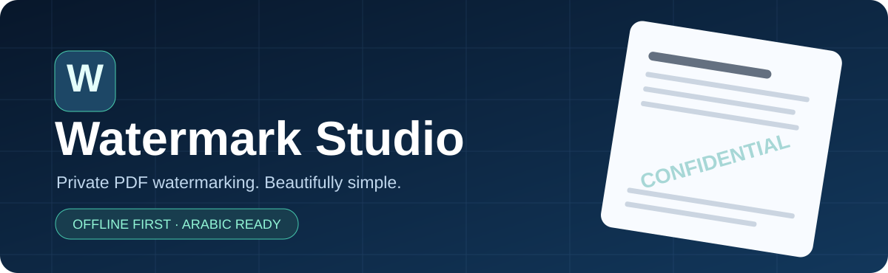
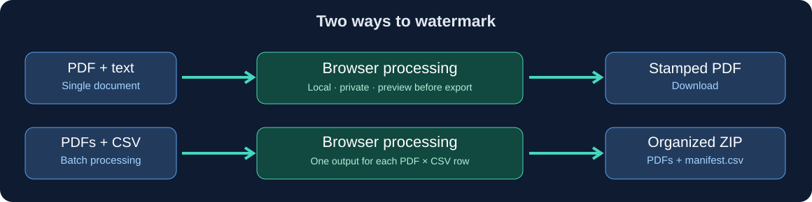

<div align="center">
  
  <h1>Watermark Studio</h1>
  <p><strong>Professional PDF watermarks. Your files stay yours.</strong></p>
  <p>علامات مائية احترافية لملفات PDF — معالجة محلية مع دعم العربية.</p>
  <p>
    <a href="https://github.com/ThamerLab/watermark-studio/actions/workflows/ci.yml"></a>
    
    
    
  </p>
  <p><a href="#-quick-start">Quick start</a> · <a href="#-features">Features</a> · <a href="#-batch-watermarking">Batch guide</a> · <a href="#-docker--server-edition">Docker / server</a> · <a href="#-development--testing">Development</a> · <a href="#-العربية">العربية</a></p>
</div>

> [!NOTE]
> The **standalone HTML edition is the primary product**. The repository also retains a **separate legacy server edition** (FastAPI + Docker + Proxmox scripts) for compatibility. Features and privacy guarantees differ between editions.

## ✨ What is Watermark Studio?

Watermark Studio helps you watermark PDFs without sending documents to a remote server when using its standalone edition. Download **one HTML file**, open it in Chrome or Edge, and work offline. It includes its JavaScript dependencies and embedded Arabic font.



*Illustration of the workflow, not a screenshot of the running application.*

## 🚀 Quick start

### Option A — Download and run (recommended)

1. Download [**watermark-studio.html**](./watermark-studio.html) (use the file's **Download raw file** button in GitHub).
2. Open it in **Microsoft Edge or Google Chrome**.
3. Select **ملف واحد** (single) or **معالجة دفعة** (batch).
4. Upload PDFs from your computer, configure the watermark and preview the result.
5. Download the watermarked PDF or batch ZIP.

**No account, local server, CLI, Docker, or internet connection is required after downloading.** The standalone file is about 2.8 MB in the current repository. Files are handled by the browser; for sensitive documents, use a trusted device and browser.

### Option B — Build from source

Prerequisites: **Node.js 22+** and npm. Browser smoke tests also require **Chrome or Edge** installed on the machine.

```bash
git clone https://github.com/ThamerLab/watermark-studio.git
cd watermark-studio
npm ci
npm run build:standalone
npm run test:standalone
```

Open the generated `watermark-studio.html` file locally. Its source is in `standalone/src/`; `standalone/build.mjs` produces the distributable file. The checked-in HTML should remain synchronized with a fresh build.

## ✅ Features

| Capability | Standalone HTML | Server edition |
|---|:---:|:---:|
| Arabic and English text watermarks | ✅ | ✅ |
| Multi-line text, opacity, rotation, size, position | ✅ | ✅ |
| Tiled/repeated watermarks | ✅ | ✅ |
| PDF page selection and preview | ✅ | ✅ |
| Single-PDF watermark | ✅ | ✅ |
| PNG/JPEG image watermark | ✅ | ✅ |
| Batch PDFs + CSV names | ✅ | ✅ |
| ZIP download with UTF-8 BOM manifest | ✅ | ✅ |
| PDF input | ✅ | ✅ |
| PowerPoint input | ❌ | ✅ (LibreOffice conversion) |
| Offline operation after download | ✅ | Depends on server |
| No document upload to a server | ✅ | ❌ (uploads to **your** server) |
| API / Docker / Proxmox | ❌ | ✅ |

> [!IMPORTANT]
> PowerPoint input and server APIs are **not** part of the browser-only HTML edition. Convert PowerPoint to PDF first, or choose the legacy server edition. This separation is intentional to avoid misleading users.

## 📦 Batch watermarking

Prepare a CSV file with these headers:

```csv
watermark_text,output_name
"CONFIDENTIAL - Team A","Team A"
"نسخة خاصة - محمد أحمد","محمد أحمد"
"Internal use only","Internal"
```

- `watermark_text`: **required** text placed on each source PDF.
- `output_name`: **optional** folder/output identifier.
- Use UTF-8 for Arabic; the downloadable CSV template includes BOM for compatibility.
- Every input PDF is combined with each CSV watermark row. For example, **3 PDFs × 4 rows = 12 output PDFs**.
- Export produces a ZIP organized by watermark and includes `_manifest.csv`.
- Output uses filename sanitization to reduce problems with Windows paths; review all exported filenames.

**Workflow:** Select PDFs → import CSV → adjust watermark → review preview → generate ZIP.

## 🎨 Watermark controls

Choose the watermark's text, font, size, color, transparency, angle, placement (including tiled), and target pages. For page selection, use **all**, **first page**, or custom selections such as `1-3,7,10-12`. The single-file workflow also supports image watermarks from PNG/JPEG.

For readable but discreet marks, start with low opacity and a diagonal angle, then preview. Appearance depends on the content and document dimensions.

## 🐳 Docker / server edition

The **existing server edition** lives under `app/` and is operated through the provided Dockerfile and Compose configuration. It is distinct from the standalone browser edition and processes documents on **your server**.

```bash
git clone https://github.com/ThamerLab/watermark-studio.git
cd watermark-studio
cp .env.example .env
docker compose up -d --build
docker compose ps
```

Open `http://localhost:8080` on the Docker host, or adjust `APP_PORT` in `.env`. The Compose service includes a health check, limited Linux privileges, a read-only root filesystem and persistent job data. Temporary documents may remain for the configured retention interval.

**Security warning:** The server app does not provide a complete authentication/authorization layer suitable for internet-facing uploads. **Do not expose it to the public internet as-is.** Use a trusted LAN or an authenticated VPN/reverse proxy with TLS and appropriate upload limits. Do not assume the standalone privacy promise applies to this edition.

### Proxmox installation (server edition)

The repository includes `install.sh`, `update.sh`, and `uninstall.sh` for deploying the Docker-based server edition inside a Proxmox LXC. Read and review scripts before execution on the Proxmox host; creating an LXC and enabling Docker changes host-managed resources.

```bash
git clone https://github.com/ThamerLab/watermark-studio.git
cd watermark-studio
bash install.sh
```

This edition requires active networking, appropriate LXC storage, a supported Debian template, and Docker installation within the container. **It is not the recommended path if you only need offline PDF watermarking.**

## 🧪 Development & testing

Two separate test paths ensure changes do not accidentally break one edition:

```bash
# Standalone edition (Node.js 22+, Chrome/Edge for smoke tests)
npm ci
npm run build:standalone
npm run test:standalone

# Server edition (Python 3.13 recommended)
python -m pip install -r requirements-dev.txt
python -m pytest -q

# Installer lint, if shellcheck is installed
shellcheck install.sh update.sh uninstall.sh
```

GitHub Actions runs the standalone Windows browser test, Python tests, shell checks, Docker build, and an integration exercise for the server's PDF/PowerPoint batch path. See [CI workflow](.github/workflows/ci.yml) and [Actions](https://github.com/ThamerLab/watermark-studio/actions).

## 🔐 Privacy and limitations

- **Standalone:** files are processed locally in the browser; the smoke test explicitly checks that no HTTP requests are made in its tested workflow.
- **Server:** your browser uploads documents to your deployment. Configure retention and network access deliberately.
- Memory and processing time increase with large PDFs, many pages, high-resolution image watermarks, and batch combinations.
- Validate downloaded PDFs before distributing sensitive documents. A visible watermark is **not** DRM, access control, or a cryptographic signature.
- For confidential workflows, avoid posting real customer files, API credentials, private documents or personal data in bug reports.

## 📁 Repository layout

```text
watermark-studio.html     # Self-contained offline browser app
standalone/
  src/                   # Browser interface and processing code
  build.mjs              # Single-file builder
  tests/                 # Browser smoke tests
app/                     # Legacy FastAPI server edition
tests/                   # Python API/processing tests
Dockerfile               # Server image
docker-compose.yml       # Server deployment
install.sh               # Proxmox LXC / Docker installer
update.sh, uninstall.sh  # Server maintenance
docs/images/             # README illustrations
.github/workflows/ci.yml # CI pipeline
```

## 🌍 العربية

**النسخة الموصى بها:** [تحميل Watermark Studio HTML](./watermark-studio.html)، ثم فتح الملف باستخدام Microsoft Edge أو Google Chrome. التطبيق يعمل محليًا في المتصفح، ولا يرفع مستنداتك إلى خادم.

**خطوات الاستخدام:** اختر ملف PDF، واكتب العلامة المائية، وحدد الحجم والشفافية والزاوية والصفحات، ثم عاين وحمّل PDF النهائي. ولمعالجة مجموعة مستندات، اختر **معالجة دفعة**، وأرفق ملفات PDF مع جدول CSV يتضمن عمود `watermark_text`، ثم حمّل ملف ZIP المنظم.

**تنبيه:** نسخة Docker/Proxmox مختلفة عن ملف HTML المستقل؛ الملفات فيها تُرسل إلى الخادم الذي تشغله أنت. ولا تدعم نسخة HTML فتح PowerPoint مباشرةً.

## 🤝 Contributing

Issues and pull requests are welcome. Include the edition used, OS/browser or Docker environment, clear reproduction steps, **sanitized** sample files and expected/actual behavior. Run relevant tests before proposing changes. Please don't attach confidential PDFs.

## 📄 License

[MIT](LICENSE). Included third-party libraries and fonts retain their respective upstream licenses. This is an independent project maintained by [ThamerLab](https://github.com/ThamerLab).
